<div align="center">

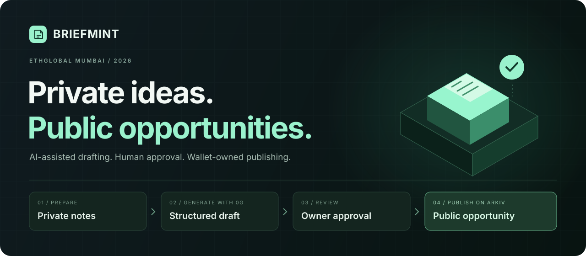

# BriefMint

**Turn private project notes into clear, owner-approved public opportunities.**

A wallet-connected workspace for community leads: draft with **0G**, review every public field,<br />
then publish a discoverable, wallet-owned opportunity on **Arkiv**, all inside **Tool City**.

[See the UI](#inside-tool-city) · [Explore the workflow](#the-workflow) · [See live evidence](#demonstrated-on-testnet) · [Run locally](#run-locally) · [Architecture](docs/architecture/ARCHITECTURE.md) · [Demo guide](docs/submission/DEMO_GUIDE.md)

**ETHGlobal Mumbai 2026** &nbsp; / &nbsp; **0G inference** &nbsp; / &nbsp; **Arkiv Rabdi**

</div>

---

## Good opportunities start before the listing

A community lead knows what needs doing. The brief is scattered across planning notes: unfinished ideas, internal constraints and requirements that still need clarification. Contributors need a clear scope, without receiving all that private context.

BriefMint turns those notes into a structured proposal with deliverables, acceptance criteria, exclusions and open questions. The owner edits the proposal, reviews its public version and approves exactly what gets published.

**The model drafts. The owner decides. The wallet publishes.**

## Inside Tool City

### A city that makes the workflow tangible

Click a building to move between the Planning Desk, AI Studio, Release Desk, Registry Hall and Archive.

<a href="docs/assets/screenshots/tool-city.png">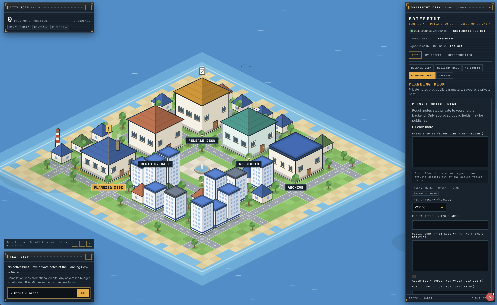</a>

<table>
<tr><th width="50%">Owner workspace</th><th width="50%">Public discovery</th></tr>
<tr>
<td><a href="docs/assets/screenshots/my-briefs.png">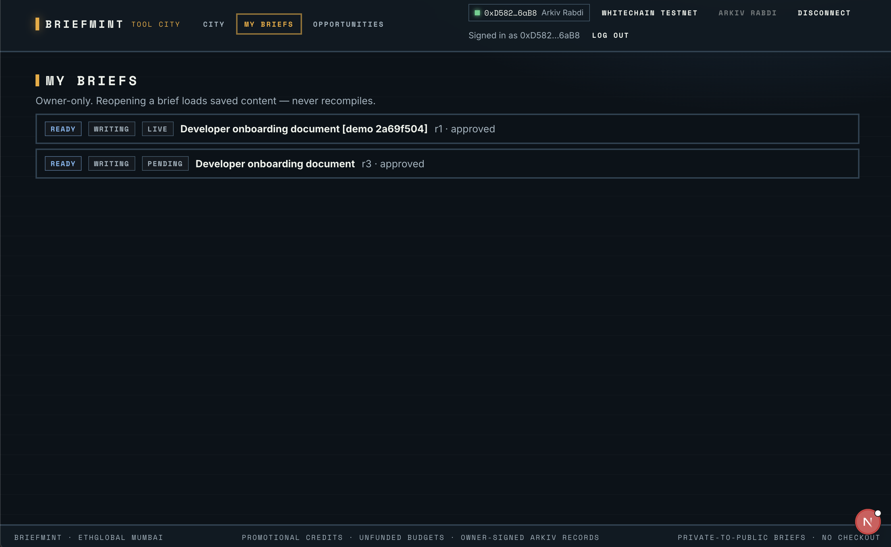</a></td>
<td><a href="docs/assets/screenshots/public-opportunities.png">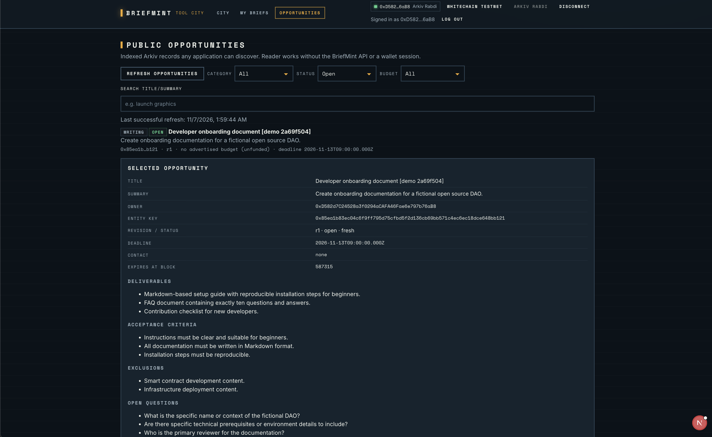</a></td>
</tr>
<tr><td>Reopen saved briefs without generating again. The published demo and unresolved original attempt retain separate identities.</td><td>Filter public records and inspect the approved scope, network owner, revision, status and native expiry.</td></tr>
</table>

<details>
<summary><strong>Independent reader UI</strong></summary>

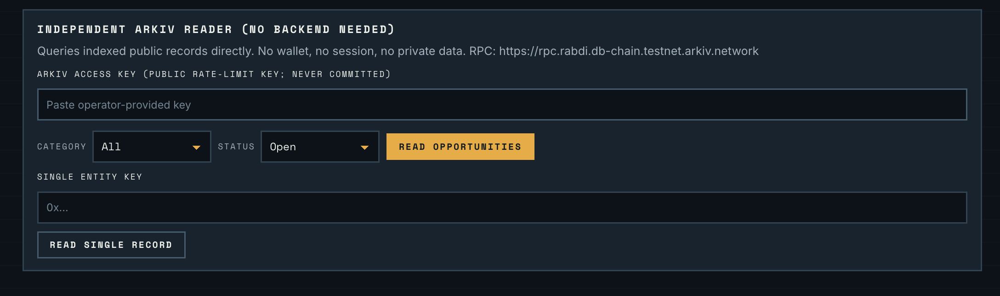

The reader queries Arkiv directly. This capture shows the form, not a query result; independent read evidence is recorded [separately](docs/evidence/LIVE_DEMO.md).

</details>

<details>
<summary><strong>Next visuals: draft review and exact public approval</strong></summary>

<table>
<tr><th width="50%">Generated draft + owner edits</th><th width="50%">Public preview + approval hash</th></tr>
<tr>
<td>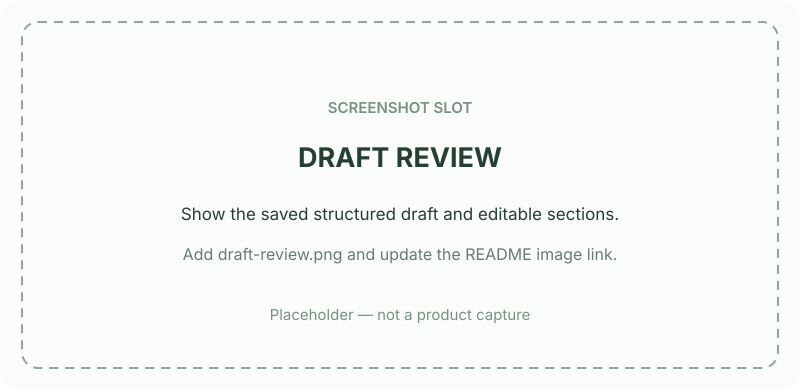</td>
<td>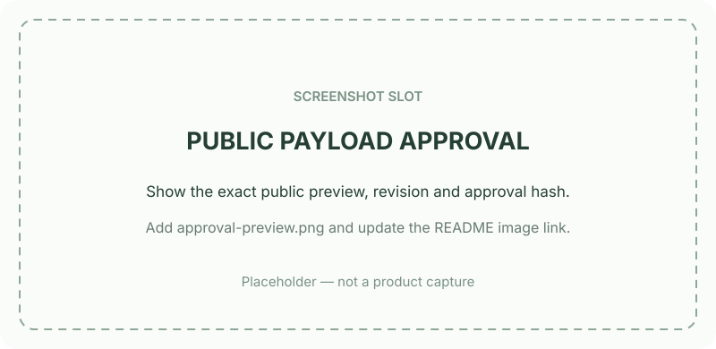</td>
</tr>
</table>

These two slots are explicitly placeholders. Add real captures as `docs/assets/screenshots/draft-review.png` and `docs/assets/screenshots/approval-preview.png`, then replace the two placeholder image paths above. [Screenshot replacement guide →](docs/assets/screenshots/README.md)

</details>

*Actual UI screenshots supplied by the operator on 7 November 2026; click to view full resolution. They show capture-time state. The visible legacy Whitechain header label does not imply BriefMint requires checkout or Whitechain funding.*

## The workflow

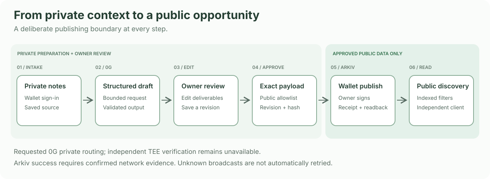


| Step | What the owner does | What BriefMint guarantees at that boundary |
|---|---|---|
| **01 · Prepare privately** | Sign in with a wallet and save project notes. | Owner-scoped access and persistent source material. |
| **02 · Generate a draft** | Deliberately request 0G generation. | Bounded dispatch, strict output validation and no public fallback. |
| **03 · Review and approve** | Edit the draft and inspect the public preview. | Approval binds an exact revision and canonical SHA-256 hash. Edits invalidate it. |
| **04 · Publish and discover** | Sign the approved Arkiv operation in the browser wallet. | Confirmed receipt and matching entity readback before publication success. |

Saved drafts can be reopened without another inference. Public opportunities can be read without a BriefMint login or access to its private database.

<details>
<summary><strong>A concrete example</strong></summary>

**Synthetic project note:** “Our fictional DAO needs beginner onboarding documentation. Include a reproducible setup guide, a ten-question FAQ and a contribution checklist. Exclude contract development and infrastructure deployment.”

**Structured draft:**

- **Deliverables:** Markdown setup guide, FAQ and contribution checklist.
- **Acceptance criteria:** beginner-friendly instructions and reproducible installation steps.
- **Exclusions:** smart contract development and infrastructure deployment.
- **Open questions:** target environment, DAO context and reviewer.

The owner can change the wording before approving the public projection. This illustrates the workflow; the actual demonstrated record is linked below.

</details>

## Demonstrated on testnet

**A real private-to-public journey has been demonstrated:** MetaMask authentication, saved private notes, genuine 0G generation, editable output, revision/hash approval, owner-signed Arkiv creation, receipt/readback and public discovery.

| Evidence | Inspect it |
|---|---|
| **Published opportunity** | Developer onboarding document [demo 2a69f504] · revision 1 · writing · open at the recorded observation |
| **Arkiv transaction** | [View on Rabdi Explorer ↗](https://rabdi.explorer.arkiv.network/tx/0x78ab3f744d123c56e985008cbf70c12a81fe1fb927f79b4220e67147b0a4c3ea) |
| **App inference** | Model `0gm-1.0-35b-a3b`; saved request ID and returned metadata in the [evidence record](docs/evidence/LIVE_DEMO.md#0g-evidence-levels) |
| **Independent read** | Standalone public reader returned the entity without app API, cookies or SQLite. |
| **Offline verification checkpoint** | 176 server tests, 27 UI tests, typecheck, lint, production build and no-billing HTTP smoke passed. [Commands and results →](docs/submission/VERIFICATION.md) |

**Verify the public entity yourself**, no wallet or application server required:

```sh
node --import tsx scripts/briefmint-arkiv-reader.ts \
  --get 0x85ea1b83ec04c6f9ff795d75cfbd5f2d136cb69bb571c4ec6ec18dce648bb121 \
  --public-endpoint
```

The anonymous endpoint is rate-limited; a later indexed query returned HTTP 429. That is a network error, not an empty catalogue. Record state can change or expire. [Full identifiers, observation times and limitations →](docs/evidence/LIVE_DEMO.md)

> **Demo status:** reuse the saved genuine draft and published entity. No public hosted demo or video URL is established yet. Live update, close and native expiry remain unverified; their regression tests use synthetic adapters.

## Two integrations, two essential jobs

### 0G · Turn private context into actionable scope

The server requests structured generation through the 0G Router using `0gm-1.0-35b-a3b`. The request selects private trust mode, asks for TEE verification, disables fallbacks and runs with a bounded timeout and no automatic retry. Returned content must pass strict schema and source-reference validation before it becomes a saved draft.

**Why it belongs:** generation is the core step between rough notes and a useful brief. Removing it removes the drafting workflow. 0G provides the requested private execution route with model/provider/request evidence retained for inspection.

**Evidence boundary:** live generation succeeded, but Router verification and routing-tier fields were absent. Independent cryptographic TEE verification is **not established**. Requested privacy settings are not attestation proof. [0G evidence and guarded probe →](docs/briefmint/0G_LIVE_PROBE.md)

### Arkiv · Give the public opportunity its own owner and index

The approved projection becomes an owner-signed entity under `tool-city.opportunity.v1` on **Rabdi, chain 7794095**. Arkiv supplies wallet ownership, indexed category/language/status/budget/deadline queries, entity identity and native expiry. The backend verifies the receipt and reads back the content; an independent reader queries the public network directly.

**Why it belongs:** the public opportunity remains queryable outside BriefMint's private service. Removing Arkiv removes that wallet-owned public record and independent discovery path.

**Evidence boundary:** create/read/discovery were demonstrated. Update/close/expiry have offline coverage only. The business deadline is a timestamp; native expiry is a network block height. [Schema](arkiv/schema.md) · [Usage](arkiv/how-you-use-arkiv.md) · [Rationale](arkiv/why-arkiv.md) · [Integration friction](arkiv/friction.md) · [Reach](arkiv/reach.md)

## Architecture

### System and integration map

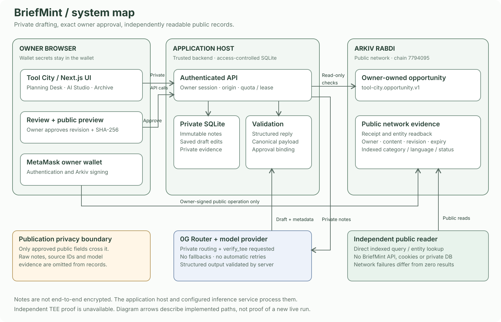

*Architecture illustration, not a live execution trace. [Open full-size map](docs/assets/briefmint-system-map.svg). Owner signatures happen in the browser; the server performs receipt and entity checks.*

<details>
<summary><strong>Editable architecture graph</strong></summary>

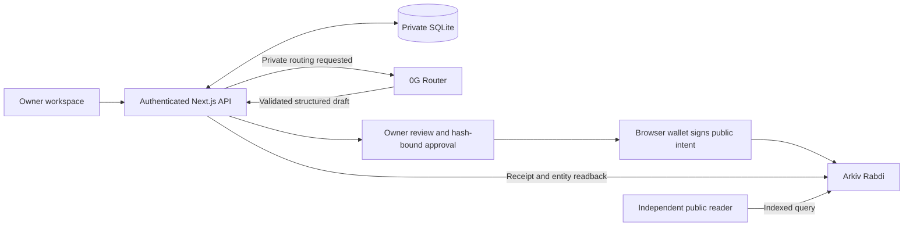

</details>

### Approval and publication state map

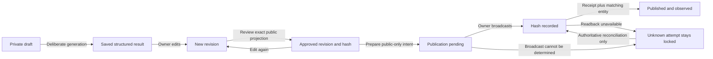

*This graph describes the intended guarded workflow, not new live activity. An unknown attempt cannot be unlocked by an empty explorer or nonce zero.*

**Private preparation and public publication use separate data representations.** Notes never flow directly from SQLite to Arkiv. Only the approved public projection is eligible for publishing.

| Layer | Technology |
|---|---|
| **Interface** | Next.js 16.4.5, React 19.3, TypeScript, Pixi.js city with SVG/CSS overlays |
| **Backend** | Node 24, Next.js route handlers, SQLite, atomic quota/lease accounting |
| **Contracts and validation** | Shared TypeScript DTOs, Zod 4, deterministic canonical JSON and SHA-256 |
| **Wallet and public data** | wagmi 3, viem 2, MetaMask, Arkiv SDK 1.0.1 |
| **Inference** | Server-only 0G Router integration, pinned model, structured response parser |

[Three detailed architecture/trust diagrams →](docs/architecture/ARCHITECTURE.md)

## Privacy by explicit boundaries

| Stays in the access-controlled backend | Becomes public only after approval |
|---|---|
| Original notes and private source references | Title, summary, category and language |
| Original model output and saved edit history | Deliverables, acceptance criteria, exclusions and questions |
| Inference evidence and internal identifiers | Optional unfunded budget/contact, deadline, status and schema/revision metadata |

The backend and inference service process the notes. **Storage is not end-to-end encrypted**, and independent TEE verification is unavailable. Structural validation excludes private fields; the owner must still review prose for accidental disclosure. Public data and backups may outlive closing or expiry.

Session ownership, origin checks and revision-bound approval protect private operations. Wallet secrets remain in the wallet. Publication requires matching onchain evidence; unknown broadcasts remain locked and are never automatically resubmitted. [Trust boundaries →](docs/architecture/ARCHITECTURE.md#data-and-security-boundary)

## Run locally

**Prerequisites:** Node **24.x**, npm, a persistent writable disk; MetaMask for owner sign-in. A fresh clone contains no private notes, generated drafts, credentials or database.

```sh
git clone --branch codex/briefmint-integration-fixes https://github.com/0xsan7/Eth-global-26-.git
cd Eth-global-26-
npm ci
test -e .env.local || cp .env.example .env.local
```

Edit the ignored `.env.local` before starting:

```dotenv
APP_ORIGIN=http://127.0.0.1:3001
AUTH_ALLOWED_ORIGINS=http://127.0.0.1:3001
SESSION_SECRET=<generate-a-random-secret-of-at-least-32-characters-locally>
DATABASE_PATH=./data/tool-city.sqlite
```

```sh
npm run dev -- --hostname 127.0.0.1 --port 3001
```

Open **http://127.0.0.1:3001**. The city is `/`, private briefs are `/briefs`, and public discovery is `/opportunities`. Frontend and API share one Next.js origin.

<details>
<summary><strong>Enable 0G generation and Arkiv reconciliation</strong></summary>

Keep credentials server-only. Never put 0G/session secrets in `NEXT_PUBLIC_*`, `VITE_*`, Git, screenshots or chat.

| Environment variables | Purpose |
|---|---|
| `ZERO_G_API_KEY`, `ZERO_G_BASE_URL`, `ZERO_G_MODEL_ID` | Router credentials, `https://router-api.0g.ai/v1`, model `0gm-1.0-35b-a3b` |
| `INFERENCE_TIMEOUT_MS` | Bounded request timeout |
| `BRIEFMINT_ALLOWED_WALLETS`, `BRIEFMINT_COMPILATIONS_PER_WALLET` | Explicit wallet allowlist and new-brief allowance |
| `BRIEFMINT_GLOBAL_DISPATCH_LIMIT`, `BRIEFMINT_QUOTA_WINDOW_ID`, `BRIEFMINT_QUOTA_WINDOW_END` | Global attempt ceiling and finite quota window |
| `ARKIV_ACCESS_KEY` | Server readback/access-rate configuration; not a wallet credential |

Missing/invalid quota configuration disables compilation. Every dispatched attempt counts globally, including uncertain attempts; the per-wallet allowance counts distinct briefs first started in the window. Current operator compute quota is exhausted: reuse saved output. Funding or checkout on Whitechain is not required.

For the operator's existing ignored `.env.0g-smoke`, this launcher loads only allowlisted server settings and does not infer at startup:

```sh
npm run dev:briefmint-0g -- --hostname 127.0.0.1 --port 3001
```

Configure the wallet for Rabdi chain **7794095** using the installed SDK/official network configuration. Publishing requires the actual owner's wallet and testnet gas. Browser public readers accept a deliberately configured public endpoint access key locally; never supply a wallet private key to the application. New inference and wallet writes require explicit operator consent.

</details>

<details>
<summary><strong>Production deployment model</strong></summary>

```sh
npm run build
HOSTNAME=127.0.0.1 PORT=3001 npm start
```

Use one Node 24 process behind HTTPS, the real public origin, Secure cookies and a persistent SQLite volume. Independent replicas and disposable serverless disks do not satisfy this storage model. Restrict volume access, back up SQLite consistently, and define retention. No production deployment is established. The build also packages the separate legacy checkout example.

</details>

## Verification and project map

```sh
npm test              # Server and UI tests with labeled synthetic fixtures
npm run typecheck
npm run lint
npm run build
npm run smoke:local   # Disposable local HTTP smoke; no inference or chain writes
```

The [recorded verification checkpoint](docs/submission/VERIFICATION.md) reports actual results; offline tests are not live sponsor evidence. Legacy simulated-chain tests remain available as `npm run test:contracts`.

| Start here | What you will find |
|---|---|
| [`src/app/`](src/app/) | City/pages and same-origin API routes |
| [`src/components/`](src/components/) | Tool City and BriefMint workflow UI |
| [`src/lib/shared/briefs.ts`](src/lib/shared/briefs.ts) | Canonical DTOs, validators and public hashing |
| [`src/lib/server/`](src/lib/server/) | Auth, persistence, inference, quota and reconciliation |
| [`src/lib/arkiv/briefmint/`](src/lib/arkiv/briefmint/) | Public schema, reader and browser writer |
| [`scripts/briefmint-arkiv-reader.ts`](scripts/briefmint-arkiv-reader.ts) | Read-only public client, independent of the application API |

## Current limits and next steps

- **Attestation:** independent cryptographic TEE verification is unavailable; missing Router evidence remains unknown. Credit debit/source was not measured.
- **Recovery:** the original approved R3 attempt remains pending without a known hash. The demonstrated entity is a separately approved copy; duplicate-content risk remains. Do not retry or clear the old intent.
- **Lifecycle:** live update, close and native expiry remain unverified. No expiry extension or reopening is provided.
- **Submission:** public hosting, video/team contacts and license/asset clearance remain operator tasks. Provider availability, quota, public RPC limits and testnet gas affect the demo.

Next: validate available attestation evidence, reconcile the original intent safely, demonstrate live lifecycle under separate consent, and deploy a persistent demo. BriefMint has no applicant inbox, escrow or payment flow; legacy translation/Whitechain code is separate.

## Team and acknowledgements

Git records contributions under **0xsan7**, **mevarx** and **VARX!!**, plus `usehoplite[bot]`. AI assistance was used in planning, implementation, testing and documentation. No affiliation, award or partnership is implied.

Inherited city/reference code, bundled fonts and dependencies require the [documented attribution review](docs/submission/ATTRIBUTION.md). **No root license has been selected**; public visibility is not an open-source license grant.

[Submission copy](docs/submission/ETHGLOBAL_SUBMISSION.md) · [Demo guide](docs/submission/DEMO_GUIDE.md) · [Recording checklist](docs/submission/RECORDING_CHECKLIST.md) · [Live evidence](docs/evidence/LIVE_DEMO.md)
