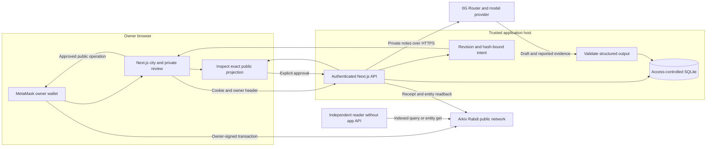
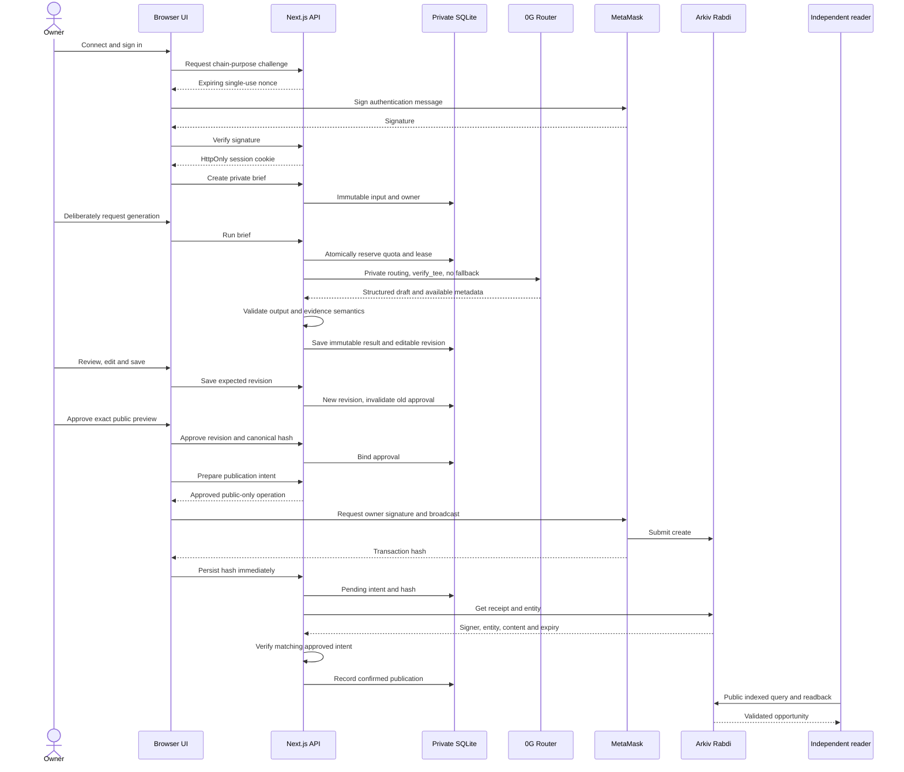
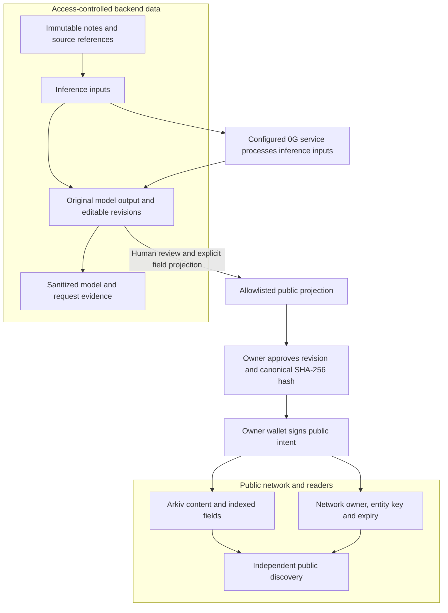

# BriefMint architecture

Current integrated Next.js application; legacy translation/payment code is separate. [README](../../README.md) provides setup; [live evidence](../evidence/LIVE_DEMO.md) qualifies observations.

## Components and trust boundaries

The application host and inference provider process private notes. Wallet secrets remain in the wallet. Independent reader means independence from the BriefMint backend, not a different chain provider or independent TEE proof.

## Execution sequence

This is the success path, not a guarantee of delivery. No hash means unknown broadcast, not proof of failure. Unknown attempts stay locked; automatic retries are forbidden. An entity transaction must target the pinned Arkiv engine and match actual owner/content/revision before success. Explicitly approved demo copies have separate identities; they do not cancel old attempts.

## Data and security boundary

Private data is protected by session ownership/origin checks and host controls, **not end-to-end encryption**. The public allowlist excludes notes, source IDs, internal IDs, prompts, evidence and credentials. It cannot prevent a human from approving a sensitive fact inside ordinary public prose.

## Implemented boundaries

| Boundary | Source |
|---|---|
| Canonical API registry, DTOs, strict validation, public hashing | [shared/briefs.ts](../../src/lib/shared/briefs.ts) |
| Auth, private persistence, quota/lease, generation | [server modules](../../src/lib/server/) |
| Server publication preparation and reconciliation | [brief-publication.ts](../../src/lib/server/brief-publication.ts) |
| Browser transaction policy and public schema/reader | [Arkiv adapters](../../src/lib/arkiv/briefmint/) |
| Independent executable reader | [briefmint-arkiv-reader.ts](../../scripts/briefmint-arkiv-reader.ts) |

The named schema is `tool-city.opportunity.v1`; [schema details](../../arkiv/schema.md) distinguish indexes from UTF-8 content and network system fields. Business deadline is a timestamp; native expiry is a network block. Creation derives expiry from the approved deadline and observed block timing. Patches do not extend lifetime.

## Runtime

One Node 24 Next.js instance serves UI and API on one origin, with persistent SQLite. Browser wallet writes; the server never signs opportunities for all users. Production needs HTTPS, matching origin configuration, Secure cookies, restricted disk access and consistent backups. Ephemeral/serverless filesystems and independent replica databases do not satisfy this deployment model. Saved results load without new inference.

## Evidence level

The operator demonstrated app generation and Arkiv create/read/discovery. Offline tests cover lifecycle/error/privacy paths. Independent TEE proof, live update/close/expiry and a public hosted deployment remain unverified. Successful request metadata records what was returned; absent verification fields remain unknown.
